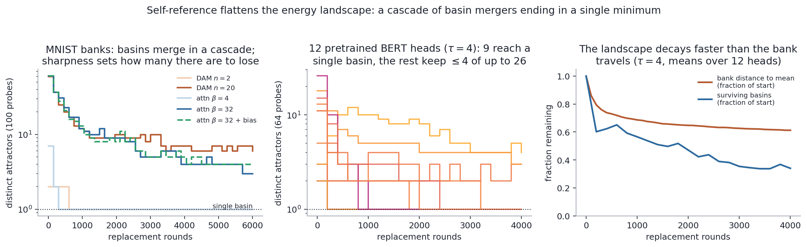

# Attention that eats itself

Code, data and figures for

> Nam H. Le. *Attention that eats itself: self-reference flattens the energy
> landscape of modern Hopfield networks and transformer attention.*
> Manuscript, 2026. PDF: [`paper/neucom.pdf`](paper/neucom.pdf)

One retrieval step of a modern Hopfield network is the transformer attention
operation. This repository studies what happens when such a memory overwrites
its own stored patterns with its own retrievals: the energy landscape flattens
one way, basins merge in a cascade to a single minimum near the data mean, and
pattern separation sets only the speed of the collapse, never its endpoint.



## Layout

| Path | What it is |
|---|---|
| `selfmodel/mhn.py` | Spin-glass substrate: log-sum-exp memory, binarizing commit, basin bias |
| `run_mhn_phase.py`, `run_mhn_selection.py` | Spin-glass neutral-drift phase diagram and basin-bias selection (Fig. 2) |
| `mnist_c0.py`, `mnist_pr_check.py` | Pre-registered difficulty and participation-ratio checks |
| `run_mnist_grid.py` | Pre-registered MNIST grid: rules x sharpness x modes x seeds (Fig. 3) |
| `llm_bank_prep.py`, `run_llm_regime.py` | Twelve pretrained `bert-base-uncased` heads under self-reference (Fig. 4) |
| `mnist_basin_census.py`, `run_llm_census.py` | Basin census of the retrieval map (Fig. 5) |
| `check_hopfield_layer.py` | Certifies the softmax rule against the reference `hflayers.Hopfield` layer |
| `make_*.py` | Figures, written to `figures_mhn/` |
| `data/` | Stored results behind every figure (`*.npz`) and the two public-domain texts used for BERT |
| `preregistration/` | The MNIST protocol, written before any run |
| `paper/` | Manuscript source and PDF |
| `tests/` | Unit tests for the spin-glass model |

## Reproducing

```bash
pip install -r requirements.txt
python -m pytest tests            # 11 tests

# figures from the stored results
python make_mhn_figures.py
python make_llm_figures.py
python make_energy_figure.py
python make_mnist_figures.py      # the bank-evolution GIF also needs data/mnist_snaps/

# rerunning the experiments
python run_mhn_phase.py
python run_mhn_selection.py
python run_mnist_grid.py          # needs data/mnist.npz (see below)
python llm_bank_prep.py           # caches BERT hidden states to data/llm_bank/
python run_llm_regime.py          # about 4 minutes on one GPU
python run_llm_census.py
python mnist_basin_census.py
```

Not included because of size, and regenerated by the scripts above:
`data/mnist.npz` (the standard Keras MNIST file,
`https://storage.googleapis.com/tensorflow/tf-keras-datasets/mnist.npz`,
or `~/.keras/datasets/mnist.npz`), `data/mnist_snaps/` (written by
`run_mnist_grid.py`) and `data/llm_bank/` (written by `llm_bank_prep.py`).

## License

MIT. The texts in `data/gutenberg/` are public domain (Project Gutenberg).
